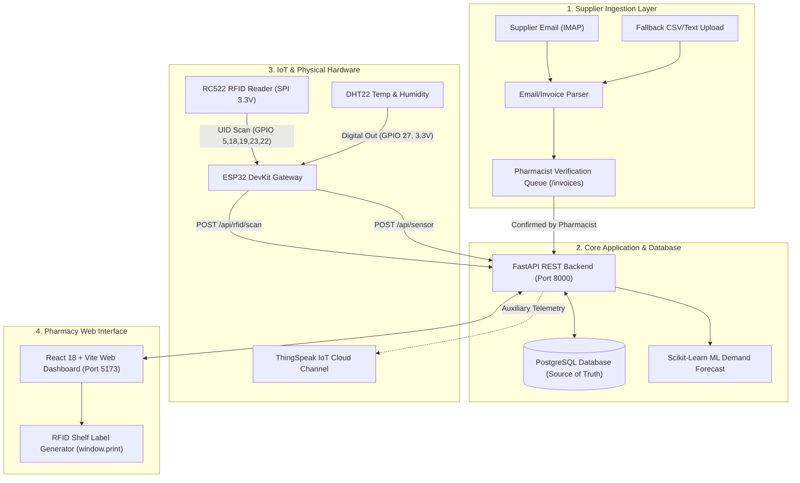

# System Architecture: Smart Pharmacy IoT Inventory & Expiry Monitoring

## 1. System Overview

The **Smart Pharmacy IoT System** is an end-to-end full-stack Internet of Everything (IoE) and clinical inventory platform tailored for pharmaceutical retail operations. It combines physical RFID scanning, environmental cold-chain monitoring, supplier email/invoice ingestion, automated 30-day expiry defense, and future demand prediction via scikit-learn machine learning.

---

## 2. Hardware Wiring Diagram & Pinouts

### ESP32 DevKit Connections
> [!WARNING]
> Do NOT connect 5V to the RC522 RFID module. Operating the RC522 at 5V will permanently damage the MFRC522 IC. Always power with 3.3V.

| Sensor / Module | Pin Name | ESP32 GPIO Pin | Voltage | Notes |
| :--- | :--- | :--- | :--- | :--- |
| **RC522 RFID** | VCC | 3.3V | 3.3V DC | Strict 3.3V power |
| **RC522 RFID** | GND | GND | 0V | Common Ground |
| **RC522 RFID** | RST | GPIO 22 | 3.3V Logic | Hardware Reset |
| **RC522 RFID** | SDA (SS) | GPIO 5 | 3.3V Logic | SPI Chip Select |
| **RC522 RFID** | MOSI | GPIO 23 | 3.3V Logic | Master Out Slave In |
| **RC522 RFID** | MISO | GPIO 19 | 3.3V Logic | Master In Slave Out |
| **RC522 RFID** | SCK | GPIO 18 | 3.3V Logic | SPI Clock |
| **RC522 RFID** | IRQ | Not Connected | — | Optional interrupt |
| **DHT22 Sensor** | VCC (+) | 3.3V | 3.3V DC | Power supply |
| **DHT22 Sensor** | DATA (OUT) | GPIO 27 | 3.3V Logic | Digital sensor reading |
| **DHT22 Sensor** | GND (-) | GND | 0V | Common Ground |

---

## 3. Core Database Entities (PostgreSQL)

- **`medicines`**: Master pharmaceutical catalog (brand name, generic chemical, dosage form, minimum/maximum temperature & humidity thresholds, reorder level).
- **`batches`**: Physical inventory lots associated with specific expiration dates, quantities received, and remaining units.
- **`rfid_tags`**: Physical chip registry (`AVAILABLE`, `ASSIGNED`, `SOLD`, `DISABLED`).
- **`transactions`**: Audit trail (`SALE`, `RESTOCK`, `ADJUSTMENT`, `RETURN`) with RFID UID and timestamp.
- **`sensor_readings`**: High-frequency temperature and humidity telemetry logs.
- **`alerts`**: Deduplicated notification triggers (`EXPIRY`, `STOCK`, `TEMPERATURE`, `HUMIDITY`, `RFID`, `SYSTEM`).
- **`email_imports`**: Raw ingested supplier messages.
- **`invoices` & `invoice_items`**: Staged delivery notes pending staff verification.

---

## 4. ThingSpeak Cloud Integration

ThingSpeak operates as an auxiliary public IoT telemetry gateway:
- **Field 1**: Storage Temperature (°C)
- **Field 2**: Storage Humidity (%)
- **Field 3**: Climate Status Code (`1` = NORMAL, `2` = WARNING, `3` = CRITICAL)
- **Field 4**: Cumulative RFID Scan Count

Rate limiting is enforced at a minimum 15-second interval. If ThingSpeak is unreachable, the system fails gracefully and maintains local PostgreSQL operations without interruption.
